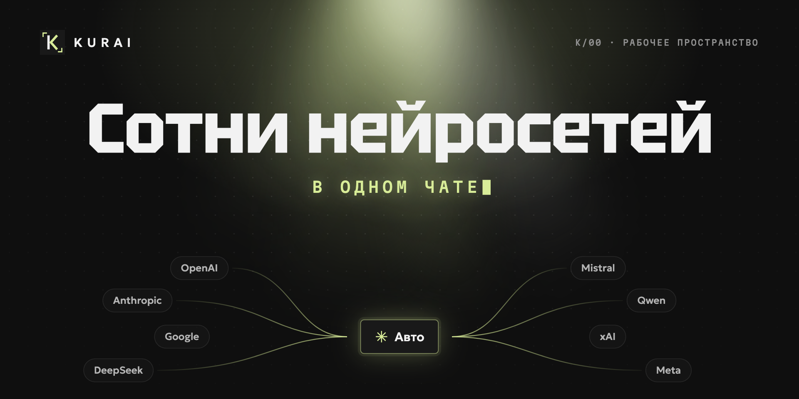
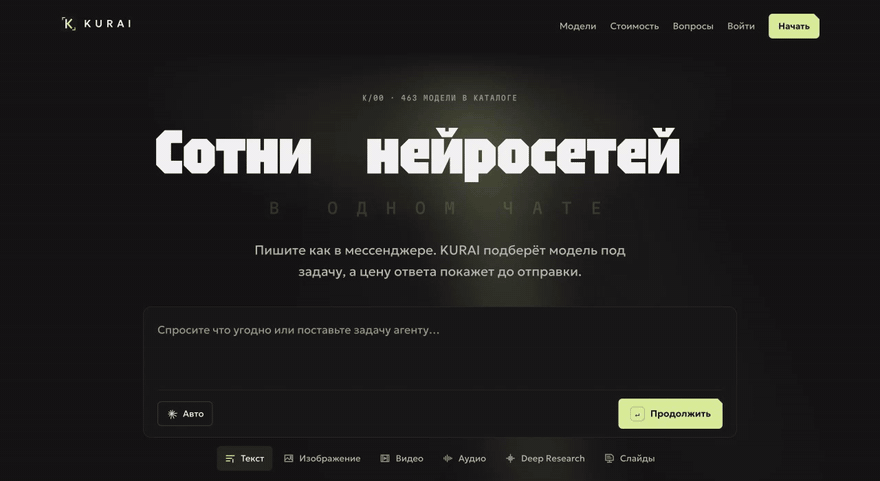
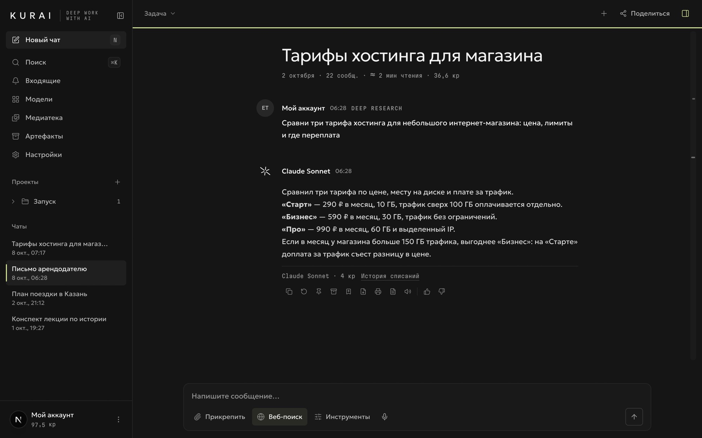
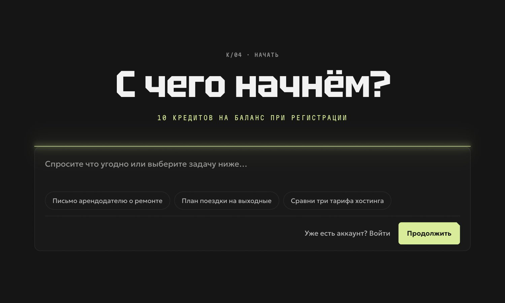
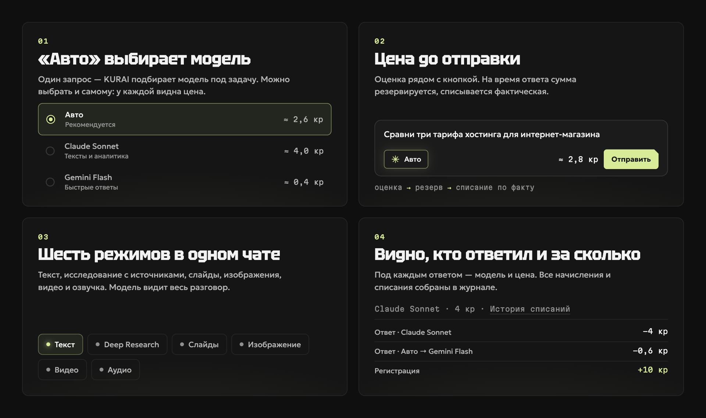
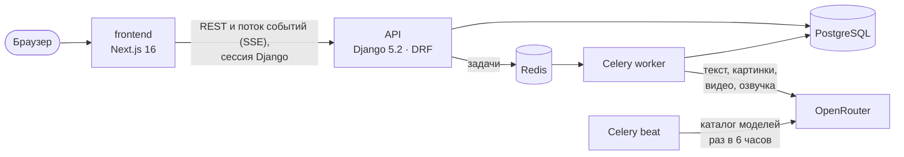

<div align="center">



# KURAI

**Сотни нейросетей в одном чате.** Пишите как в мессенджере: KURAI подберёт модель под задачу, а цену ответа покажет до отправки.


[Возможности](#возможности) · [Как это устроено](#как-это-устроено) · [Быстрый старт](#быстрый-старт) · [Настройка](#настройка) · [Тесты](#тесты) · [Выкладка](#выкладка) · [Планы](#планы)

</div>

---

## О проекте

KURAI — один чат для текстовых моделей, генерации картинок, видео и озвучки. Человеку не нужно разбираться, какая нейросеть лучше: режим «Авто» выбирает её сам, а под каждым ответом видно, кто ответил и сколько это стоило.

Оплата — кредитами за запросы, без подписки. Цена видна ещё до отправки, на время ответа сумма резервируется, а списывается фактическая; если модель не ответила, резерв возвращается.

<p align="center">
  
</p>

<table>
  <tr>
    <td width="58%"></td>
    <td width="42%"></td>
  </tr>
  <tr>
    <td align="center"><sub>Кабинет: под ответом — модель и цена</sub></td>
    <td align="center"><sub>Лендинг: начать можно сразу с задачи</sub></td>
  </tr>
</table>

## Возможности



| | |
|---|---|
| **Модели** | Сотни текстовых моделей, десятки моделей для картинок, видео и озвучки. Каталог и цены обновляются автоматически каждые 6 часов. |
| **Режим «Авто»** | Подбирает модель под запрос. Модель можно выбрать и вручную: у каждой указана цена типового запроса. |
| **Цена до отправки** | Оценка видна рядом с кнопкой, резерв кредитов на время ответа, списание по факту, журнал операций без правок задним числом. |
| **Режимы** | Текст, Deep Research с источниками, слайды с выгрузкой в `.pptx`, изображения, видео, озвучка. |
| **Работа с задачами** | Чаты и проекты, ветки ответов, вложения, медиатека, архив, ссылка на чат только для чтения. |
| **Вход** | Email и пароль с подтверждением почты и сбросом пароля, вход через Telegram. |
| **Данные участника** | Выгрузка профиля, чатов и журнала кредитов одним ZIP-архивом. |
| **Интерфейс** | Единая дизайн-система для лендинга и кабинета, тёмная и светлая темы, «Спокойный режим» и уважение к настройке «уменьшить движение». |

## Как это устроено



- **Сервер — источник правды.** Цена, резерв и списание считаются только на сервере: браузер не может подсказать цену или модель задним числом. Запуск требует ключ идемпотентности, повторный запрос не спишет кредиты дважды.
- **Запросы к моделям — вне HTTP-запроса.** Их выполняет воркер Celery, а браузер получает ответ потоком событий. Поток можно переподключить без потери текста: события хранятся в базе.
- **Ключи провайдера — только на сервере.** В браузер не уходят ни ключ, ни адреса файлов у провайдера: картинки, видео и аудио сохраняются у нас и отдаются только владельцу.

Подробнее о сервере — [backend/README.md](backend/README.md), о фронтенде — [frontend/README.md](frontend/README.md).

## Стек

| Часть | Технологии |
|---|---|
| Фронтенд | Next.js 16 (App Router, Turbopack), React 19, TypeScript, Tailwind CSS 4, Motion |
| Бэкенд | Django 5.2, Django REST Framework, drf-spectacular (OpenAPI) |
| Фоновые задачи | Celery 5.5, Redis 7 |
| База данных | PostgreSQL 16 в проде, SQLite для локальной разработки |
| Модели | OpenRouter: текст, изображения, видео, синтез речи |
| Тесты | pytest + pytest-django, Vitest + Testing Library |

## Быстрый старт

Нужны Python 3.12 и Node.js 20+.

```bash
git clone https://github.com/deuteriumZzz/KURAI.git
cd KURAI
```

**Сервер** (терминал 1):

```bash
cd backend
python3.12 -m venv .venv
.venv/bin/pip install -e . pytest pytest-django
cp .env.example .env          # впишите OPENROUTER_API_KEY
.venv/bin/python manage.py migrate
.venv/bin/python manage.py sync_openrouter_models
.venv/bin/python manage.py runserver 8000
```

**Сайт** (терминал 2):

```bash
cd frontend
cp .env.example .env.local
npm install
npm run dev                   # http://localhost:3000
```

Без ключа OpenRouter всё запускается: интерфейс, каталог и кредиты работают, а текстовые ответы приходят от локальной заглушки, чтобы было на чём проверять интерфейс.

## Настройка

Локально переменные лежат в `backend/.env` и `frontend/.env.local`, в проде — в одном `.env` в корне. Полные списки — в `backend/.env.example`, `frontend/.env.example` и `.env.production.example`.

**Сервер**

| Переменная | Зачем |
|---|---|
| `OPENROUTER_API_KEY` | Ключ провайдера моделей. Без него вне режима разработки сервер не запустится. |
| `DJANGO_SECRET_KEY` | Секрет Django. В проде — длинная случайная строка. |
| `DJANGO_DEBUG` | `1` локально, `0` в проде. |
| `DJANGO_ALLOWED_HOSTS`, `CORS_ALLOWED_ORIGINS` | Домены сервера и сайта. |
| `DATABASE_URL` | PostgreSQL в проде; локально, если не задана, — SQLite. |
| `KURAI_QUEUE_RUNS`, `KURAI_LOCAL_EXECUTE_RUNS` | Очередь Celery в проде (`1` / `0`), выполнение в процессе сервера локально (`0` / `1`). |
| `EMAIL_HOST` и соседние `EMAIL_*` | Почта для подтверждения адреса и сброса пароля. Пусто — письма печатаются в лог сервера. |
| `KURAI_FRONTEND_URL` | Адрес сайта для ссылок в письмах. |
| `TELEGRAM_BOT_TOKEN` | Токен бота для входа через Telegram. Пусто — входа через Telegram нет. |

**Сайт**

| Переменная | Зачем |
|---|---|
| `NEXT_PUBLIC_KURAI_API_BASE_URL` | Адрес API. Пусто — сайт работает как автономный прототип на демо-данных. |
| `NEXT_PUBLIC_SITE_URL` | Публичный адрес сайта для метаданных и превью ссылок. |
| `NEXT_PUBLIC_TELEGRAM_BOT_USERNAME` | Имя бота без `@`. Вместе с `TELEGRAM_BOT_TOKEN` включает кнопку входа через Telegram; домен сайта задаётся у [@BotFather](https://t.me/BotFather) командой `/setdomain`. |

## Структура репозитория

```text
KURAI/
├── frontend/              сайт и кабинет на Next.js
│   ├── src/app/           маршруты: лендинг, вход, кабинет, документы
│   ├── src/components/    интерфейс: чат, поле ввода, лендинг, эффекты
│   └── src/lib/           клиент API, форматирование, движение
├── backend/               API на Django
│   ├── accounts/          участники, вход по почте и через Telegram
│   ├── workspace/         проекты, чаты, сообщения
│   ├── runs/              запуски моделей, события, провайдер, воркер
│   ├── ledger/            кредиты: резерв, списание, журнал
│   ├── model_catalog/     каталог моделей и цены
│   ├── media/ files/      медиатека и вложения
│   └── sharing/           ссылки на чат только для чтения
├── deploy/nginx/          nginx: HTTPS, /api/ — Django, остальное — Next.js
├── docker-compose.yml     прод на одном сервере: nginx, сайт, API, воркер, beat, PostgreSQL, Redis, certbot
├── docs/                  продуктовые и UX-документы
├── DESIGN.md              дизайн-система: цвет, шрифты, движение
└── PRODUCT.md             продукт и аудитория
```

## API

Схема OpenAPI отдаётся сервером по адресу `/api/schema`, контракт лежит в [backend/contracts/openapi.yaml](backend/contracts/openapi.yaml).

Служебные адреса: `/api/v1/health` (жив ли процесс), `/api/v1/ready` (готова ли база), `/api/v1/status` (каталог и доступные режимы, без внутренних подробностей).

## Тесты

```bash
# сервер
cd backend && .venv/bin/python -m pytest

# сайт
cd frontend && npm test && npm run typecheck && npm run lint
```

## Выкладка

Весь продукт поднимается на одном сервере через [docker-compose.yml](docker-compose.yml). nginx принимает HTTPS и делит трафик: `/api/` уходит в Django, остальное — в Next.js. Рядом работают воркер и beat Celery, PostgreSQL, Redis и certbot, который сам продлевает сертификат. Сайт и API живут на одном домене, поэтому CORS не нужен.

Нужны сервер с Docker, домен с A-записью на этот сервер и открытые порты 80 и 443.

```bash
git clone https://github.com/deuteriumZzz/KURAI.git && cd KURAI
cp .env.production.example .env        # домен, секреты, ключ OpenRouter, почта
```

Первый сертификат Let's Encrypt (один раз, пока порт 80 свободен):

```bash
docker compose run --rm -p 80:80 --entrypoint certbot certbot certonly --standalone -d kurai.example.com -m you@example.com --agree-tos --no-eff-email
```

Запуск и первая загрузка каталога моделей:

```bash
docker compose up -d --build
docker compose exec api python manage.py sync_openrouter_models
```

Обновление — `git pull && docker compose up -d --build`: миграции применяются при старте API. Адрес сайта и имя Telegram-бота попадают в сайт при сборке, после их смены образ сайта пересобирается той же командой.

Перед открытием для людей проверьте почту, `/api/v1/status` и переменные из раздела [Настройка](#настройка).

## Дизайн

Лендинг и кабинет собраны на одной системе: графитовая палитра и один лаймовый акцент, три шрифта (Tektur для заголовков, Geologica для текста, Martian Mono для цифр), одна геометрия углов. Свет один, меняется только громкость: на лендинге он громче, в кабинете подсвечивает только активное и важное. Все правила — в [DESIGN.md](DESIGN.md).

## Планы

- [ ] Оплата и пакеты кредитов в рублях
- [ ] Английский интерфейс
- [ ] Выбор голоса для озвучки и формат картинки параметром модели
- [ ] Выкладка в прод

## Лицензия

Лицензия пока не выбрана: все права на код принадлежат авторам проекта.
