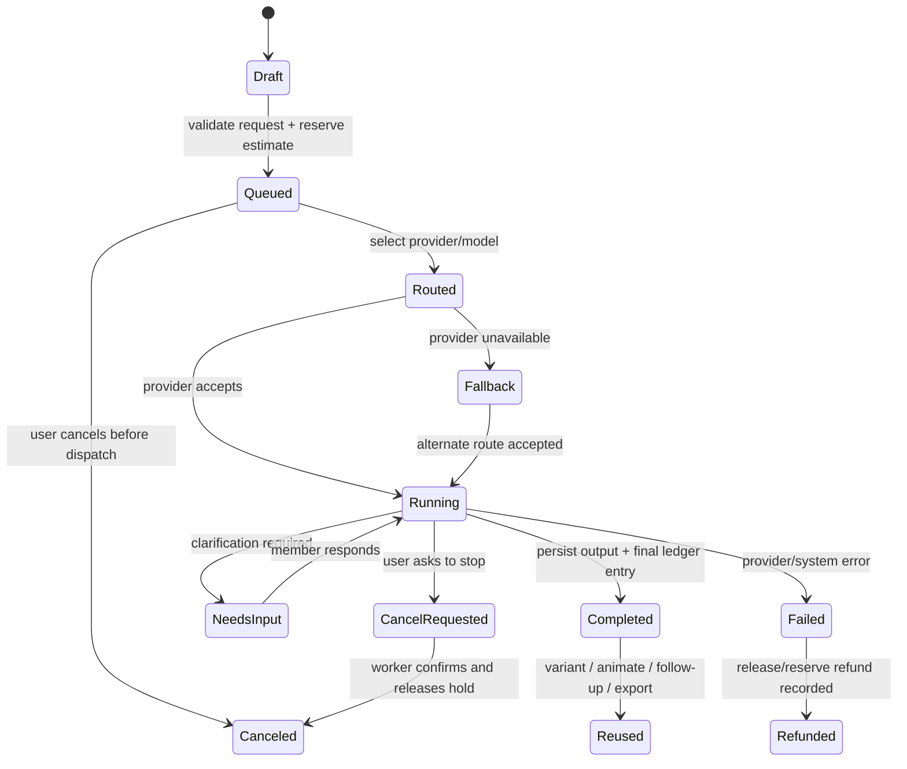
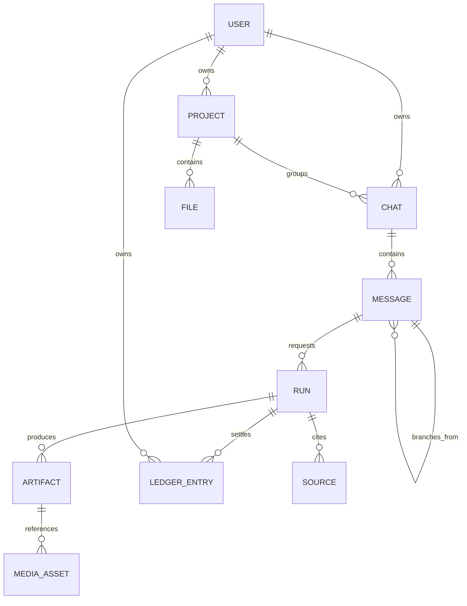

# KURAI — capability contract

## CAPABILITY

KURAI gives a Russian-speaking creator or small team one reliable place to
turn an intention into useful output — chat, research, image, video, voice,
documents or slides — while the system selects and routes AI providers,
states the cost beforehand, preserves the work context and explains every
charge or fallback. The product should feel like a living studio with clear
system presence, not an empty model catalogue or a game HUD.

## PRODUCT THESIS

The competitive advantage is not a longer list of models.

- **Kimi contribution:** one calm work surface, project memory, task-first
  composition and low cognitive load.
- **Cyberpunk contribution:** precision, atmosphere and a visible system that
  reacts to real work — a route selected, sources being read, an image ready,
  a provider unavailable — never decorative role-play.
- **Aggregator contribution:** choice without decision fatigue; KURAI owns
  routing, cost, fallback, provenance and a reusable output library.
- **Award-quality bar:** every surface has a deliberate hierarchy, a strong
  primary action, tangible feedback and a visual rhythm. The product must be
  memorable in motion but usable when all motion is off.

## CONSTRAINTS

### Fixed product rules

1. The landing page is a separate marketing surface. It shares the same
   material, typography and trust rules as the workspace, but never pretends
   to be a live dashboard.
2. A user starts with an outcome, not a provider. The compatible model is
   always visible and selectable before a run begins; routing evidence stays
   attached to the result.
3. Price is known before dispatch. Charges, refunds and provider fallbacks
   are immutable, attributable records.
4. A project, chat, uploaded file and generated asset belong to one account;
   sharing is explicit and revocable.
5. A message is append-only after send. Edits create a branch; generation
   results retain model, route, cost and source provenance.
6. Cyber visual effects communicate real state, do not move readable content,
   and obey `prefers-reduced-motion` and the KURAI calm preference.
7. Mobile preserves the ability to create, understand, stop, reuse and share
   work. Hover cannot be the only route to a required action.

### Trust boundaries

- Browser clients never receive provider keys, payment secrets or unrestricted
  OpenRouter credentials.
- Credits are integer minor units; balances are changed only by a ledger entry
  in the same transaction as the related operation.
- User content, uploaded files and share links require account-level access
  checks on every read/write path.
- Markdown, remote previews and model output are treated as untrusted content
  and sanitised before rendering.

## IMPLEMENTATION CONTRACT

### Actors and surfaces

| Actor | Surfaces | Outcome |
| --- | --- | --- |
| Guest | landing, public model pages, sign-in | understands value and can create an account |
| Member | workspace, chat, projects, media, billing, settings | completes and reuses work safely |
| Share viewer | explicit shared chat/artifact link | reads a frozen, permission-scoped result |
| Operator | provider health, routing incidents, payments, moderation | resolves failures without exposing private content |

### Core lifecycle

### Required backend domains

1. **Identity and access** — user, session, device session, consent,
   account status and share-link scope.
2. **Workspace graph** — project, chat, branchable message, attachment,
   artifact, source and reusable media record.
3. **Generation orchestration** — validated request, cost quote, queued run,
   provider route, SSE/WebSocket events, cancel, retry and idempotency key.
4. **Model registry and router** — capability, availability, price schedule,
   safety policy, ordered fallback routes and a human-readable route reason.
5. **Money** — immutable credit ledger, payment intent/webhook, promo,
   subscription entitlement, reserve/settle/refund and invoice receipt.
6. **Files and media** — signed upload/download URLs, scan status, media
   provenance, thumbnails, retention and deletion jobs.
7. **Operations** — audit events, provider health, queue depth, failed runs,
   payment webhook reconciliation and support-safe trace lookup.

### Minimum data relationships

### API shape (versioned `/v1`)

- `POST /runs/quote` returns a validated request quote and route candidates;
  it cannot create a charge.
- `POST /runs` accepts an idempotency key, creates one run and emits an event
  URL; the server owns provider invocation.
- `GET /runs/{id}/events` is SSE with route, progress, source, output, done,
  refunded and error events. Events are durable enough for reconnect.
- `POST /runs/{id}/cancel` is safe to repeat and returns the terminal state.
- `/projects`, `/chats`, `/messages`, `/files`, `/media`, `/ledger` expose
  account-scoped resources with cursor pagination and consistent error
  envelopes.
- `POST /messages/{id}/exports/slides` creates a private `.pptx` attachment
  from an owned assistant answer; it never creates a public artifact URL.
- `GET /me/export` returns a private ZIP with a member's portable profile,
  workspace graph and ledger history. It excludes credential material and raw
  uploaded-file bytes.
- Payment webhooks are verified, deduplicated and isolated from browser
  redirects.

### Observability and reliability

- Correlation IDs follow quote → run → provider call → ledger entry.
- Track time-to-first-token/frame, completion, fallback rate, refund rate,
  cost variance, upload scan failures and abandoned payment intents.
- Expose a status page from actual provider health, not mock indicators.
- Queue and provider failure must result in a clear member state with retry,
  fallback or refund; never a silent spinner.

## NON-GOALS

- Building a general social network, virtual character, game economy or
  provider-branded dashboard.
- Storing plaintext payment credentials or exposing direct provider access to
  the browser.
- Claiming “all models” without a maintained model registry and routing policy.
- Copying Cyberpunk 2077 assets, UI screens or brand material.

## OPEN QUESTIONS

These require product/legal decisions before production backend work:

1. Which legal entity, payment countries/currencies and fiscal receipt flow
   will be supported at launch?
2. Which providers and modalities are launch-critical, and what content/safety
   policy applies to each?
3. What storage region, retention period and deletion SLA are promised to
   Russian users?
4. Is a team workspace/role model required for v1, or is v1 strictly personal
   accounts with share links?
5. What is the source of truth for retail pricing and margin rules when a
   provider price changes during a queued job?

## CURRENT DELIVERY

The implemented MVP path is: authentication → workspace → selected-model quote
→ credit hold/settlement → durable events → chat persistence. It includes
OpenRouter text streaming, source-backed research through OpenRouter's bounded
server-side web-search tool, image generation, TTS and asynchronous video jobs;
the latter are polled by bounded worker tasks and are downloaded only from
OpenRouter's documented authenticated content endpoint. Server-synchronised
model capabilities and pricing, owner-scoped attachments, and private
generated-media downloads are part of the same contract. The typed frontend client activates when
`NEXT_PUBLIC_KURAI_API_BASE_URL` is configured and keeps the visual prototype
usable offline otherwise. Connected chat uses cookie-authenticated SSE for
durable output deltas and refreshes an authoritative chat snapshot after a
terminal event or temporary network failure.

The authenticated MVP uses server-backed email/password sign-up and sign-in.
Telegram OAuth and email password recovery are not represented as working
options until their signed server callbacks and mail-delivery flows exist. A
frontend build without an API origin presents an explicitly local interface
preview instead of accepting credentials or creating a pretend account.
Email confirmation links are likewise deferred; sign-up creates a session
directly until a verified mail-delivery lifecycle is introduced.

The deployed API also exposes anonymous liveness and database-readiness probes
at `/api/v1/health` and `/api/v1/ready`. Diagnostic responses intentionally do
not expose hosts, credentials or provider internals; all HTTP responses include
a validated-or-generated `X-Request-ID` for support correlation.

`/api/v1/status` is also evidence-based: it reports `degraded` with safe
reason codes when the provider key is absent, the catalog is empty, or the
catalog exceeds its configured freshness window. The public status page turns
those codes into clear member-facing guidance without revealing credentials or
infrastructure topology.

Research citations are validated as HTTP(S) URLs before persistence, stored as
owner-scoped `RunSource` rows, emitted as durable SSE `source` events and
projected into the answer so citations survive reload. The research quote
reserves the configured bounded server-tool budget. A member can also export
any owned textual assistant response as a private KURAI-branded `.pptx` file;
the export is generated on demand and never receives a public URL.

A member may save an owned completed textual response as a private artifact.
The server creates the snapshot from the immutable answer rather than accepting
an arbitrary browser body, and retains the originating message, chat/project,
resolved model, settled cost and available source citations. The artifact
library supports returning to its source chat or handing the bounded snapshot
into a new prompt without a public URL.

A member may also save a completed route as one private reusable recipe. The
server derives it from the answer's owned, completed run: it retains the
original prompt, mode, resolved model and settled source cost. Saving the same
answer again is idempotent and returns the existing recipe, preventing an
accidental double-click from creating duplicate routes.

Member uploads are allow-listed by extension and declared MIME type, then
checked against a bounded file signature before they are persisted. Private
attachments and generated media are served only after an owner check with
`Cache-Control: private, no-store`, so authenticated output is not retained by
shared browser or intermediary caches. This is a first-line validation layer;
production malware scanning still requires a configured object-store and scan
worker.

An owner can create a private, read-only chat link that expires within a
bounded period (one hour to 30 days). It uses an opaque high-entropy token,
never a chat identifier. The server freezes an allow-listed public projection
(title and textual user/assistant messages only) at creation; internal IDs,
attachments, asset URLs, sources and system messages never enter the public
payload. Later work stays private, and the owner can replace or revoke the
single active link from the workspace. Expired, revoked or legacy links without
a snapshot return the same not-found response, avoiding disclosure of which
condition occurred. Anonymous reads have a bounded rate limit.

`/api/v1/capabilities` and `/api/v1/status` are the single source of truth for
the connected UI: a mode is available only when its compatible catalog models
exist and the server has an OpenRouter key. The product does not display
synthetic uptime, payment availability or fallback behaviour as a live
operational fact.

Payments, provider fallback policy, malware scanning, team RBAC and
retention/deletion jobs remain explicit production milestones. Video has an
important policy constraint: its provider-side async workflow has unavoidable
temporary retention, so it must not be enabled in a deployment that enforces
zero-data-retention routing.
